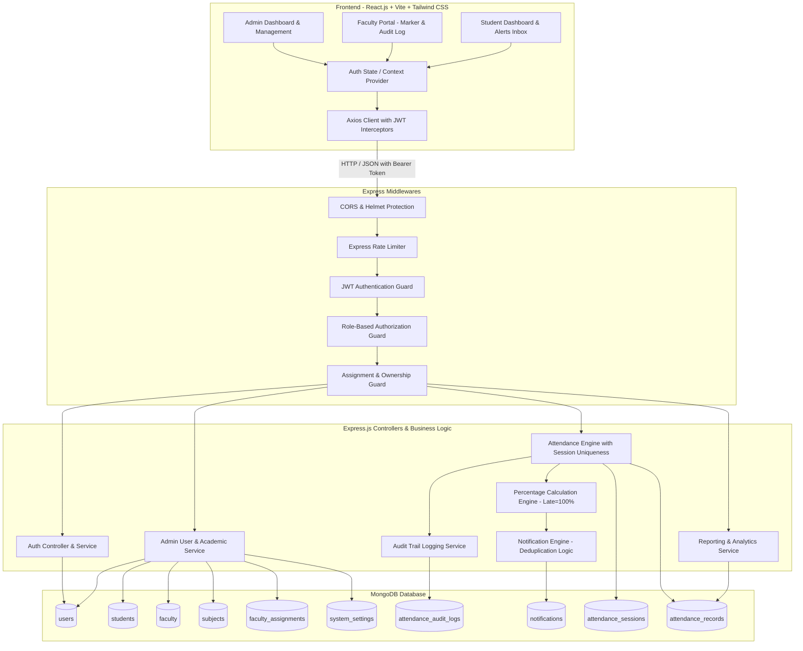
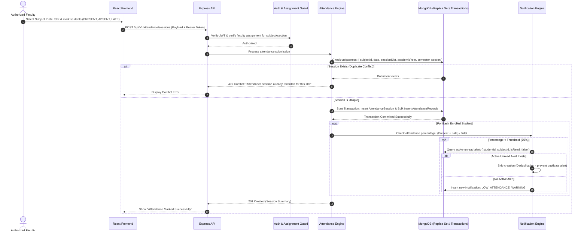
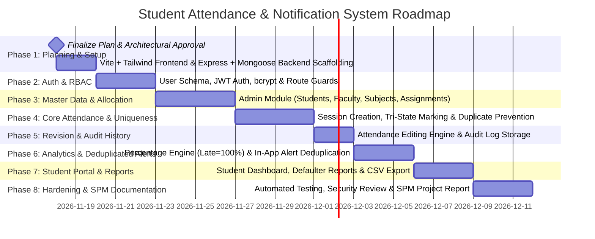

# Project Plan: Student Attendance and Notification System
**Course / Context:** Software Engineering and Project Management (SPM) Micro-Project  
**Author / Architect:** Software Architect & Project Planner  
**Date:** November 17, 2026  
**Status:** Finalized Architectural Plan (Awaiting Implementation Approval)

---

## 1. Project Overview

The **Student Attendance and Notification System** is a production-grade, full-stack web application designed to modernize, automate, and secure attendance tracking and notification workflows within academic institutions. 

In traditional college workflows, attendance logging relies on physical paper registers or unvalidated spreadsheets. These manual methods are error-prone, vulnerable to proxy attendance and accidental duplicate entries, and fail to provide timely warnings to students facing attendance shortages.

This system provides a centralized, role-based, tamper-resistant platform built with the modern **MERN + Vite** stack:
- **Frontend:** React.js (bootstrapped with Vite for high performance and fast HMR)
- **Styling:** Tailwind CSS (utility-first, responsive, component-driven UI; Lucide React icons optional)
- **Backend:** Node.js with Express.js (modular RESTful API architecture)
- **Database:** MongoDB with Mongoose Object Data Modeling (ODM)
- **Authentication & Security:** JSON Web Tokens (JWT) and bcrypt password hashing

The system guarantees strict data integrity through compound unique constraints at the database and application levels, provides real-time attendance percentage analytics, maintains immutable audit trails for record modifications, and delivers in-app notifications when a student's attendance falls below a configurable institutional threshold (default: 75%).

---

## 2. Problem Statement

Manual and semi-automated attendance operations suffer from significant operational challenges:
1. **Data Inaccuracy & Duplicate Records:** Physical registers and spreadsheets lack automated constraints, permitting accidental duplicate entries for the same student and class session.
2. **Delayed Feedback Loops:** Students often learn about attendance shortages only at the end of the academic term when hall tickets or exam eligibility lists are published, eliminating opportunities for proactive recovery.
3. **Faculty Overhead:** Faculty members spend considerable time manually computing total conducted lectures and attended lectures to derive attendance percentages.
4. **Lack of Authorization Boundaries:** Without strict access control, it is difficult to guarantee that only the specific faculty member assigned to a course can log or modify attendance records.
5. **Absence of Auditability:** When records are corrected or altered, manual systems leave no audit history detailing who modified the attendance, when it was changed, or what the prior status was.

---

## 3. Objectives

- **Automate Attendance Recording:** Provide faculty with an intuitive interface to log class session attendance in bulk with immediate validation.
- **Enforce Data Integrity & Zero Duplication:** Implement database-level and application-level unique constraints preventing duplicate session creation and duplicate student records.
- **Enforce Strict Role-Based Access Control (RBAC):** Secure features across three roles: Admin, Faculty, and Student.
- **Real-Time Analytical Calculations:** Dynamically compute subject-wise and aggregate attendance percentages:
  $$\text{Attendance \%} = \left(\frac{\text{Attended Sessions}}{\text{Total Sessions}}\right) \times 100$$
  where `PRESENT` and `LATE` both grant 100% attendance credit (with `LATE` tracked separately for disciplinary records).
- **Proactive In-App Notifications:** Deliver instant in-app alerts when a student drops below the configurable threshold (default 75%), with deduplication logic to prevent spamming active alerts.
- **Accountability & Audit Logging:** Maintain complete audit histories (`oldStatus`, `newStatus`, `modifiedBy`, `modifiedAt`) whenever an authorized faculty member edits attendance.
- **Engineering Excellence for SPM:** Deliver modular, maintainable code adhering to Twelve-Factor app principles, clean schema validation, and complete separation of concerns.

---

## 4. Scope

### In-Scope (Version 1 Deliverables)
- **Authentication & Authorization:** Secure login with JWT and bcrypt, role-based route guards, and token invalidation on logout.
- **Master Data Administration (Admin):** Closed registration where Admin creates and manages Student profiles, Faculty accounts, Academic Departments, Semesters, Sections, and Subjects.
- **Department/Semester/Section-Based Enrollment:** Students belong to a Department, Semester, and Section (e.g., CSE, 5th Semester, Section A). All students in that cohort are automatically enrolled in the subjects assigned to that cohort.
- **Faculty-to-Subject Assignment:** Admin explicitly maps faculty to subjects and sections; only assigned faculty can mark or edit attendance for that cohort.
- **Attendance Session Management:** Creation of sessions with uniqueness enforced across `{ subjectId, date, sessionSlot, academicYear, semester, section }`.
- **Tri-State Attendance Recording:** Supports `PRESENT`, `ABSENT`, and `LATE` (LATE receives 100% attendance credit while maintaining distinct logging).
- **Attendance Modification & Audit Trails:** Authorized faculty can edit attendance records for assigned subjects, generating immutable audit records (`oldStatus`, `newStatus`, `modifiedBy`, `modifiedAt`).
- **Student Dashboard:** Student-facing view with color-coded percentage indicators, attended/total session statistics, session logs, and personal notification inbox.
- **In-App Notification Engine:** Real-time notifications for low attendance with active-alert deduplication (preventing duplicate unread alerts for the same student and subject).
- **Configurable Settings:** Admin configuration for the global low-attendance warning threshold (default: 75%).
- **Class & Defaulter Reports:** Filterable summaries for Faculty and Admin with export capabilities.

### Out-of-Scope (Deferred to Future Versions)
- Individual student elective course selection (all enrollment in v1 is cohort-based by department, semester, and section).
- Public self-registration (all student and faculty accounts are provisioned exclusively by Admin).
- External SMS gateways or push notification services (in-app notification center is the sole notification mechanism in v1).
- Biometric, RFID, or QR-code hardware scanner integrations.
- Multi-college federation or payment gateway integrations.

---

## 5. Functional Requirements (FR)

| ID | Requirement | Description | Target Role |
| :--- | :--- | :--- | :--- |
| **FR-01** | User Authentication | Secure login using email and password; generates a signed JWT containing user ID and role. | All |
| **FR-02** | Role-Based Authorization | Route guards and API middleware restrict access based on user role (`ADMIN`, `FACULTY`, `STUDENT`). | All |
| **FR-03** | User Provisioning | Admin creates and manages Student and Faculty accounts. No public registration is permitted. | Admin |
| **FR-04** | Academic Cohort & Subject Setup | Admin configures Departments, Semesters, Sections, and Subjects. | Admin |
| **FR-05** | Faculty Assignment | Admin assigns faculty members to specific subjects, sections, and academic years. | Admin |
| **FR-06** | Cohort Student Population | When marking attendance, the system automatically retrieves all active students matching the subject's department, semester, and section. | Faculty |
| **FR-07** | Session Creation & Conflict Check | Faculty initiates a session (Date, Session Slot, Subject, Section, Academic Year, Semester). Rejects duplicate sessions. | Faculty |
| **FR-08** | Tri-State Attendance Marking | Faculty records attendance for each student as `PRESENT`, `ABSENT`, or `LATE`. | Faculty |
| **FR-09** | Record Uniqueness Enforcement | Enforces `{ sessionId, studentId }` uniqueness at database index and application levels. | System |
| **FR-10** | Attendance Revision & Audit Log | Authorized faculty updates a record. System writes an audit log with `oldStatus`, `newStatus`, `modifiedBy`, and `modifiedAt`. | Faculty / System |
| **FR-11** | Accurate Percentage Computation | Computes subject attendance: $\frac{\text{Present} + \text{Late}}{\text{Total Sessions}} \times 100$. Handled safely when Total Sessions = 0. | System |
| **FR-12** | Deduplicated Low-Attendance Alert | When attendance drops $< 75\%$, creates an in-app alert. Skips creation if an unread alert already exists for that student and subject. | System |
| **FR-13** | Notification Status Management | Students view in-app alerts and mark them as read. | Student |
| **FR-14** | Student Data Isolation | Students can query and view only their own attendance data and notifications; foreign IDs are rejected with 403 Forbidden. | Student / System |
| **FR-15** | Threshold Configuration | Admin modifies the institutional low-attendance threshold (e.g., 75%, 80%). | Admin |
| **FR-16** | Attendance & Defaulter Reports | Admin and Faculty view aggregated class reports and lists of students below the threshold. | Admin / Faculty |

---

## 6. Non-Functional Requirements (NFR)

### 6.1 Security & Access Control
- **Password Hashing:** Passwords hashed using `bcrypt` with a minimum of 10 salt rounds before persistence.
- **Stateless Tokens:** JWT tokens signed with a high-entropy secret (`JWT_SECRET`) loaded from `.env`, with expiration (default: 8h).
- **Strict Role-Based Access Control (RBAC):** Middleware checks `req.user.role` on every protected route.
- **Ownership Verification (IDOR Defense):**
  - Faculty can only mark/edit attendance for subjects assigned to them in `faculty_assignments`.
  - Students can access only records matching their authenticated `userId` / `studentId`.
- **Injection Defense:** Input validation using schemas (`zod`), alongside `express-mongo-sanitize` to strip query selector injection (`$gt`, `$ne`).
- **HTTP Security:** Standard security headers enabled via `helmet`, CORS restricted to the frontend Vite client origin, and rate limiting applied to auth routes.

### 6.2 Data Integrity & Transaction Management
- **Compound Uniqueness:** MongoDB compound unique indexes enforce uniqueness on sessions and individual records.
- **Atomic Session & Record Persistence:** Attendance marking (session document creation + bulk record insertion) executed inside a MongoDB session transaction (`withTransaction`) where supported, ensuring no orphan sessions exist without records.
- **Audit Immutability:** Audit trail records are append-only and cannot be updated or deleted by faculty or students.

### 6.3 Performance & Responsiveness
- **API Response Target:** Query response times $< 200\text{ ms}$ for standard dashboard and attendance marking endpoints.
- **Index Optimization:** Compound indexes on query paths (`{ studentId: 1, subjectId: 1 }`, `{ subjectId: 1, date: 1 }`).
- **Responsive Layout:** Tailwind CSS layout functional on mobile phones (faculty marking on mobile), tablets, and desktop displays.

### 6.4 Maintainability, Portability & 12-Factor Compliance
- **No Hardcoded Secrets:** Zero hardcoded API keys, secrets, or connection strings. All configuration loaded via `dotenv`.
- **Modular Directory Structure:** Separation of routes, controllers, services, models, middlewares, and client components.
- **Environment Isolation:** Clear separation between development, testing, and production runtime settings.

---

## 7. User Roles and Permissions Matrix

| Feature / Operation | Admin | Faculty | Student |
| :--- | :---: | :---: | :---: |
| Authenticate / Log in | Yes | Yes | Yes |
| Create / Edit / Deactivate User Accounts | **Full CRUD** | None | None |
| Manage Departments, Semesters, Sections & Subjects | **Full CRUD** | Read-Only | Read-Only |
| Assign Faculty to Subjects / Sections | **Full CRUD** | Read-Only (Assigned) | None |
| View Student Rosters by Department/Section | Yes | Yes (Assigned) | None |
| Mark Attendance for Class Session | None | **Yes (Assigned Only)** | None |
| Edit Attendance Records | None (or Admin Override)| **Yes (Assigned Only)** | None |
| View Modification Audit Trails | Yes | Yes (Assigned) | None |
| View Class Attendance Summary & Defaulter List | Yes | Yes (Assigned) | None |
| View Personal Dashboard & Percentage Gauge | None | None | **Yes (Self Only)** |
| View Personal Attendance Logs & Timelines | None | None | **Yes (Self Only)** |
| View In-App Low Attendance Notifications | None | None | **Yes (Self Only)** |
| Mark In-App Notifications as Read | None | None | **Yes (Self Only)** |
| Configure Low-Attendance Threshold | **Yes** | None | None |

---

## 8. Proposed Architecture

### 8.1 System Architectural Diagram



### 8.2 Sequence Diagram: Attendance Marking, Duplicate Rejection & Deduplicated Notifications



---

## 9. Finalized Design Decisions

The following architectural and domain design decisions are finalized for the implementation:

1. **Attendance Status Spectrum & Weighting:**
   - Three valid statuses: `PRESENT`, `ABSENT`, and `LATE`.
   - `LATE` receives **100% attendance credit** (treated as attended in mathematical percentage calculations), but the specific `LATE` status is preserved in the database for faculty disciplinary tracking.
   - Calculation formula:
     $$\text{Attendance Percentage} = \frac{\text{Count}(\text{PRESENT}) + \text{Count}(\text{LATE})}{\text{Total Conducted Sessions}} \times 100$$
2. **Academic & Enrollment Structure:**
   - Student enrollment is strictly **Department, Semester, and Section-based**.
   - All students belonging to `{ department: "CSE", semester: 5, section: "A" }` are automatically enrolled in all subjects assigned to that cohort.
   - Individual student elective course selection is explicitly out of scope for Version 1.
3. **Compound Uniqueness Constraints:**
   - **Attendance Session Uniqueness:** Enforced across six fields:
     $$\{\text{subjectId}, \text{date}, \text{sessionSlot}, \text{academicYear}, \text{semester}, \text{section}\}$$
   - **Attendance Record Uniqueness:** Enforced across two fields:
     $$\{\text{sessionId}, \text{studentId}\}$$
4. **Attendance Modification & Audit History:**
   - Authorized faculty can edit attendance records for assigned subjects.
   - Any status change automatically generates an immutable audit entry recording `oldStatus`, `newStatus`, `modifiedBy` (faculty ID), `modifiedAt` (timestamp), and optional `remarks`.
5. **In-App Notification Delivery & Deduplication:**
   - Solely in-app notifications (no external SMS or email dependencies).
   - **Alert Deduplication:** The notification engine will **not** generate duplicate active (unread) low-attendance notifications for the same student and subject. If a student is already flagged below 75% and has an unread alert, subsequent absent marks will not spam new alerts. A new notification is generated only if the previous alert was read or if the student's attendance temporarily recovered above 75% and dropped again.
   - Notifications track a binary `isRead` status (read / unread).
6. **User Account Provisioning:**
   - Strictly closed registration. Only the Admin can create Student and Faculty accounts (via Admin UI or batch CSV import).
   - No public self-registration.
7. **Technology Stack Confirmation:**
   - Frontend: React.js with Vite
   - Styling: Tailwind CSS (Lucide React icons optional for clean UI)
   - Backend: Node.js with Express.js
   - Database: MongoDB with Mongoose ODM
   - Security: JWT and bcrypt

---

## 10. Database Collections, Fields, and MongoDB Considerations

### 10.1 Schema Definitions

#### `users`
```javascript
{
  _id: ObjectId,
  name: { type: String, required: true, trim: true },
  email: { type: String, required: true, unique: true, lowercase: true, trim: true },
  password: { type: String, required: true }, // bcrypt hashed
  role: { type: String, required: true, enum: ['ADMIN', 'FACULTY', 'STUDENT'] },
  isActive: { type: Boolean, default: true },
  createdAt: { type: Date, default: Date.now },
  updatedAt: { type: Date, default: Date.now }
}
```

#### `students`
```javascript
{
  _id: ObjectId,
  userId: { type: ObjectId, ref: 'User', required: true, unique: true },
  rollNumber: { type: String, required: true, unique: true, uppercase: true, trim: true },
  department: { type: String, required: true, trim: true }, // e.g., 'CSE'
  semester: { type: Number, required: true, min: 1, max: 8 },
  section: { type: String, required: true, uppercase: true, trim: true }, // e.g., 'A'
  academicYear: { type: String, required: true, trim: true }, // e.g., '2026-2027'
  createdAt: { type: Date, default: Date.now },
  updatedAt: { type: Date, default: Date.now }
}
```

#### `faculty`
```javascript
{
  _id: ObjectId,
  userId: { type: ObjectId, ref: 'User', required: true, unique: true },
  facultyCode: { type: String, required: true, unique: true, uppercase: true, trim: true },
  department: { type: String, required: true, trim: true },
  designation: { type: String, default: 'Assistant Professor', trim: true },
  createdAt: { type: Date, default: Date.now },
  updatedAt: { type: Date, default: Date.now }
}
```

#### `subjects`
```javascript
{
  _id: ObjectId,
  subjectCode: { type: String, required: true, unique: true, uppercase: true, trim: true },
  name: { type: String, required: true, trim: true },
  department: { type: String, required: true, trim: true },
  semester: { type: Number, required: true },
  credits: { type: Number, default: 3 },
  isActive: { type: Boolean, default: true },
  createdAt: { type: Date, default: Date.now }
}
```

#### `faculty_assignments`
```javascript
{
  _id: ObjectId,
  facultyId: { type: ObjectId, ref: 'Faculty', required: true },
  subjectId: { type: ObjectId, ref: 'Subject', required: true },
  department: { type: String, required: true },
  semester: { type: Number, required: true },
  section: { type: String, required: true, uppercase: true },
  academicYear: { type: String, required: true },
  createdAt: { type: Date, default: Date.now }
}
```
*Index:* `{ facultyId: 1, subjectId: 1, academicYear: 1, semester: 1, section: 1 }` (Unique).

#### `attendance_sessions`
```javascript
{
  _id: ObjectId,
  subjectId: { type: ObjectId, ref: 'Subject', required: true },
  facultyId: { type: ObjectId, ref: 'Faculty', required: true },
  date: { type: Date, required: true },
  sessionSlot: { type: String, required: true, trim: true }, // e.g., 'Period 1 (09:00 - 10:00)'
  academicYear: { type: String, required: true },
  semester: { type: Number, required: true },
  section: { type: String, required: true, uppercase: true },
  topicCovered: { type: String, default: '', trim: true },
  totalCount: { type: Number, default: 0 },
  presentCount: { type: Number, default: 0 },
  absentCount: { type: Number, default: 0 },
  lateCount: { type: Number, default: 0 },
  createdAt: { type: Date, default: Date.now }
}
```
*Compound Unique Index (Session Uniqueness):*
```javascript
{ subjectId: 1, date: 1, sessionSlot: 1, academicYear: 1, semester: 1, section: 1 } // unique: true
```

#### `attendance_records`
```javascript
{
  _id: ObjectId,
  sessionId: { type: ObjectId, ref: 'AttendanceSession', required: true },
  studentId: { type: ObjectId, ref: 'Student', required: true },
  subjectId: { type: ObjectId, ref: 'Subject', required: true },
  date: { type: Date, required: true },
  status: { type: String, required: true, enum: ['PRESENT', 'ABSENT', 'LATE'] },
  markedBy: { type: ObjectId, ref: 'Faculty', required: true },
  remarks: { type: String, default: '' },
  createdAt: { type: Date, default: Date.now },
  updatedAt: { type: Date, default: Date.now }
}
```
*Compound Unique Index (Record Uniqueness):*
```javascript
{ sessionId: 1, studentId: 1 } // unique: true
```
*Query Performance Index:*
```javascript
{ studentId: 1, subjectId: 1 }
```

#### `attendance_audit_logs`
```javascript
{
  _id: ObjectId,
  recordId: { type: ObjectId, ref: 'AttendanceRecord', required: true },
  sessionId: { type: ObjectId, ref: 'AttendanceSession', required: true },
  studentId: { type: ObjectId, ref: 'Student', required: true },
  subjectId: { type: ObjectId, ref: 'Subject', required: true },
  oldStatus: { type: String, required: true, enum: ['PRESENT', 'ABSENT', 'LATE'] },
  newStatus: { type: String, required: true, enum: ['PRESENT', 'ABSENT', 'LATE'] },
  modifiedBy: { type: ObjectId, ref: 'User', required: true }, // Faculty or Admin
  modifiedAt: { type: Date, default: Date.now },
  reason: { type: String, default: 'Status correction by faculty' }
}
```

#### `notifications`
```javascript
{
  _id: ObjectId,
  recipientUserId: { type: ObjectId, ref: 'User', required: true },
  studentId: { type: ObjectId, ref: 'Student', required: true },
  subjectId: { type: ObjectId, ref: 'Subject', required: true },
  type: { type: String, default: 'LOW_ATTENDANCE_WARNING', enum: ['LOW_ATTENDANCE_WARNING', 'ATTENDANCE_CORRECTION', 'GENERAL'] },
  title: { type: String, required: true },
  message: { type: String, required: true },
  currentPercentage: { type: Number, required: true },
  threshold: { type: Number, default: 75 },
  isRead: { type: Boolean, default: false },
  createdAt: { type: Date, default: Date.now }
}
```
*Index for Deduplication Querying:*
```javascript
{ studentId: 1, subjectId: 1, isRead: 1, type: 1 }
```

#### `system_settings`
```javascript
{
  _id: ObjectId,
  key: { type: String, required: true, unique: true }, // 'LOW_ATTENDANCE_THRESHOLD'
  value: { type: mongoose.Schema.Types.Mixed, default: 75 },
  description: { type: String },
  updatedBy: { type: ObjectId, ref: 'User' },
  updatedAt: { type: Date, default: Date.now }
}
```

### 10.2 MongoDB Transactions, References & Environment Considerations

1. **Schema References & Referential Integrity:**
   - Foreign references (`ref: 'User'`, `ref: 'Student'`, `ref: 'Subject'`) are enforced at the service layer prior to record persistence.
   - Cascading or protective deletion: A Subject cannot be deleted if active `attendance_sessions` or `faculty_assignments` exist.
2. **Database Transactions (`withTransaction`):**
   - When a faculty member marks attendance, the application performs:
     1. Insert of `AttendanceSession` document.
     2. Bulk insert of $N$ `AttendanceRecord` documents.
   - This two-step operation must be atomic to prevent orphan sessions without records or records without session headers.
3. **Local Development vs. Production Deployment:**
   - **Local Development Consideration:** Standalone local MongoDB installations do not support multi-document transactions unless configured as a single-node replica set (`mongod --replSet rs0`). To support developers who run standalone MongoDB locally without replica sets, the service layer will feature a transactional wrapper that checks `mongoose.connection.client.topology.description.type`:
     - If replica set is active $\rightarrow$ executes operations within `session.withTransaction()`.
     - If standalone $\rightarrow$ executes atomic sequential operations with application-level rollback on failure.
   - **Production / Cloud Deployment Consideration:** Production environments (e.g., MongoDB Atlas) are replica sets by default, natively supporting full ACID multi-document transactions without configuration changes.

---

## 11. Main Modules and Acceptance Criteria

### Module 1: Authentication & RBAC Module
- **Scope:** Login, token issuance, password validation, protected routes, and role verification.
- **Acceptance Criteria:**
  - Given valid credentials, system returns signed JWT token with user ID and role (`ADMIN`, `FACULTY`, `STUDENT`).
  - Given invalid credentials, system returns HTTP 401 Unauthorized without disclosing whether email or password was wrong.
  - Route guards block unauthorized access (e.g., Student accessing Admin endpoints returns HTTP 403 Forbidden).
  - Passwords stored in DB are securely hashed with bcrypt (salt rounds $\ge 10$); plaintext never appears in logs.

### Module 2: User & Academic Master Data Module (Admin)
- **Scope:** CRUD for Students, Faculty, Subjects, and academic cohort configurations.
- **Acceptance Criteria:**
  - Admin can create Student accounts with unique Roll Number, Department, Semester, Section, and Academic Year.
  - Admin can create Faculty accounts with unique Faculty Code and Department.
  - Public registration route does not exist.
  - Deleting an entity with existing attendance linkages is prevented with descriptive 400 validation error.

### Module 3: Faculty Allocation & Authorization Module
- **Scope:** Assignment of faculty members to subjects, academic years, semesters, and sections.
- **Acceptance Criteria:**
  - Admin can assign a faculty member to a specific subject, semester, section, and academic year.
  - Duplicate assignments for the same faculty, subject, and section are rejected via unique compound index.
  - Faculty dashboard lists only subjects actively assigned to that faculty member.

### Module 4: Attendance Session & Marking Engine
- **Scope:** Session initiation, cohort retrieval, bulk marking, and duplicate prevention.
- **Acceptance Criteria:**
  - When marking attendance, the system loads all students matching the subject's department, semester, and section.
  - Faculty can assign statuses: `PRESENT`, `ABSENT`, or `LATE`.
  - Submitting attendance for an identical `{ subjectId, date, sessionSlot, academicYear, semester, section }` returns HTTP 409 Conflict with message: `"Attendance session already exists for this slot."`
  - Uniqueness constraint `{ sessionId, studentId }` prevents multiple records per student per session.
  - Unauthorized faculty attempting to mark attendance for unassigned subjects receives HTTP 403 Forbidden.

### Module 5: Attendance Revision & Audit Trail Module
- **Scope:** Authorized edits to existing attendance records with automatic audit logging.
- **Acceptance Criteria:**
  - Only the assigned faculty (or Admin) can modify past records for a session.
  - Modifying a record from `ABSENT` to `PRESENT` creates an immutable entry in `attendance_audit_logs` storing `oldStatus: 'ABSENT'`, `newStatus: 'PRESENT'`, `modifiedBy`, and `modifiedAt`.
  - Recalculates session summary counts (`presentCount`, `absentCount`, `lateCount`) upon update.

### Module 6: Calculation & Analytics Engine
- **Scope:** Dynamic computation of attendance percentages.
- **Acceptance Criteria:**
  - Formula correctly computes: $\frac{\text{Present} + \text{Late}}{\text{Total Sessions}} \times 100$.
  - Edge case of 0 conducted sessions outputs 100% or 0% (standardized to 100% initial eligibility or "N/A - No sessions conducted").
  - Percentages update in real time immediately following session submission or record edits.

### Module 7: In-App Notification & Deduplication Engine
- **Scope:** Triggering and deduplicating low-attendance warnings.
- **Acceptance Criteria:**
  - When a student's calculated percentage drops below the threshold (default 75%), an in-app notification is generated.
  - **Deduplication:** If an unread `LOW_ATTENDANCE_WARNING` alert already exists for that student and subject, no duplicate alert is created.
  - If a student's attendance improves $\ge 75\%$ and subsequently drops below 75% again, a new notification is generated.
  - Student can view notifications and mark them as read (`isRead: true`).

### Module 8: Student Dashboard & Self-Service Portal
- **Scope:** Student personal views, gauges, timelines, and notification center.
- **Acceptance Criteria:**
  - Student views subject-wise attendance with clear visual indicators (Green $\ge 75\%$, Amber $65-74\%$, Red $< 65\%$).
  - Student can view detailed date-wise attendance records with status (`PRESENT`, `ABSENT`, `LATE`).
  - Student attempting to access another student's record via URL/API receives HTTP 403 Forbidden.

### Module 9: Reporting & Defaulter Tracking Module
- **Scope:** Class summaries, subject reports, and defaulter lists.
- **Acceptance Criteria:**
  - Faculty can view an aggregated attendance grid for their assigned classes.
  - Admin can generate a campus-wide or department-wide defaulter list of all students with attendance $< 75\%$.
  - Reports can be exported to CSV format.

### Module 10: System Configuration Module
- **Scope:** Global settings management.
- **Acceptance Criteria:**
  - Admin can update `LOW_ATTENDANCE_THRESHOLD` (e.g., from 75 to 80).
  - Updating the threshold instantly applies to subsequent percentage checks and alerts.

---

## 12. Proposed API Endpoints

### 12.1 Authentication (`/api/v1/auth`)
| Method | Endpoint | Access | Description |
| :--- | :--- | :--- | :--- |
| `POST` | `/api/v1/auth/login` | Public | Authenticates user; returns JWT token & user profile |
| `GET` | `/api/v1/auth/me` | Authenticated | Retrieves current logged-in user profile & role |
| `POST` | `/api/v1/auth/change-password` | Authenticated | Updates current user's password |

### 12.2 Admin Management (`/api/v1/admin`)
| Method | Endpoint | Access | Description |
| :--- | :--- | :--- | :--- |
| `GET/POST` | `/api/v1/admin/students` | Admin | List all students / Create new student profile |
| `GET/PUT/DEL`| `/api/v1/admin/students/:id` | Admin | Get, update, or deactivate student profile |
| `POST` | `/api/v1/admin/students/bulk` | Admin | Bulk upload students via CSV/JSON |
| `GET/POST` | `/api/v1/admin/faculty` | Admin | List all faculty / Create faculty account |
| `GET/PUT/DEL`| `/api/v1/admin/faculty/:id` | Admin | Get, update, or deactivate faculty profile |
| `GET/POST` | `/api/v1/admin/subjects` | Admin | List all subjects / Create subject |
| `GET/PUT/DEL`| `/api/v1/admin/subjects/:id` | Admin | Get, update, or deactivate subject |
| `GET/POST` | `/api/v1/admin/assignments` | Admin | List / Create faculty-to-subject assignments |
| `DELETE` | `/api/v1/admin/assignments/:id`| Admin | Delete faculty assignment |
| `GET/PUT` | `/api/v1/admin/settings` | Admin | Get / Update global settings (threshold: 75%) |

### 12.3 Faculty Management (`/api/v1/faculty`)
| Method | Endpoint | Access | Description |
| :--- | :--- | :--- | :--- |
| `GET` | `/api/v1/faculty/my-subjects` | Faculty | List subjects/sections assigned to logged-in faculty |
| `GET` | `/api/v1/faculty/cohort-students` | Faculty | Get students in cohort (`department`, `semester`, `section`) |

### 12.4 Attendance Operations (`/api/v1/attendance`)
| Method | Endpoint | Access | Description |
| :--- | :--- | :--- | :--- |
| `POST` | `/api/v1/attendance/sessions` | Faculty | Create session and submit bulk student attendance |
| `GET` | `/api/v1/attendance/sessions` | Faculty/Admin | List sessions filtered by subject, section, date range |
| `GET` | `/api/v1/attendance/sessions/:id` | Faculty/Admin | Get detailed student attendance for a session |
| `PUT` | `/api/v1/attendance/records/:id` | Faculty (Assigned)| Edit individual student attendance status (triggers audit log)|
| `GET` | `/api/v1/attendance/audit-logs/:sessionId`| Faculty/Admin | View modification audit logs for a session |
| `GET` | `/api/v1/attendance/summary/subject/:subjectId`| Faculty/Admin| Get class attendance summary & defaulter list |

### 12.5 Student Operations (`/api/v1/student`)
| Method | Endpoint | Access | Description |
| :--- | :--- | :--- | :--- |
| `GET` | `/api/v1/student/dashboard` | Student (Self)| Get subject-wise attendance percentages & stats |
| `GET` | `/api/v1/student/history/:subjectId` | Student (Self)| Get date-wise session history for a specific subject |
| `GET` | `/api/v1/student/notifications` | Student (Self)| List in-app notifications (unread prioritized) |
| `PATCH`| `/api/v1/student/notifications/:id/read`| Student (Self)| Mark a notification as read |

---

## 13. Security Considerations

1. **Strict Role-Based Authorization (RBAC):** Every endpoint protected by token authentication (`verifyToken`) and role validation (`requireRole(['ADMIN'])`).
2. **Horizontal Privilege Escalation (IDOR) Mitigation:**
   - On student endpoints, `studentId` is resolved exclusively from `req.user.id`, ignoring manipulated query parameters.
   - On attendance marking and editing, `req.user.id` is checked against `faculty_assignments` for the specific subject and section.
3. **NoSQL Injection Defense:** Mongoose schema typing and `express-mongo-sanitize` middleware neutralize operators such as `{"$gt": ""}`.
4. **Credential Protection & Password Policy:** bcrypt hashing with at least 10 rounds; passwords must meet minimum complexity (at least 8 characters, alphanumeric).
5. **Rate Limiting:** Protects `/api/v1/auth/login` with `express-rate-limit` (maximum 5 attempts per 15-minute window).
6. **Zero Hardcoded Secrets:** Strict `.env` isolation; `.gitignore` includes all environment configuration files.

---

## 14. Testing Strategy

1. **Unit Testing:**
   - Percentage calculation logic: Verify `PRESENT` + `LATE` yields 100% credit per session.
   - Zero-session handling and boundary conditions (e.g., 74.9% vs 75.0%).
   - Audit trail generator verifying that `oldStatus` and `newStatus` are captured faithfully.
2. **Integration Testing:**
   - **Session Duplicate Prevention Test:** Submitting two identical session payloads must return HTTP 409 Conflict.
   - **Record Duplicate Prevention Test:** Attempting duplicate `{ sessionId, studentId }` inserts must throw a compound index collision error.
   - **Notification Deduplication Test:** Consecutive absent submissions for a student already below 75% must not produce duplicate unread alerts.
   - **RBAC Guard Tests:** Verify that Students receive HTTP 403 when invoking Faculty/Admin endpoints.
3. **End-to-End (E2E) & SPM Verification:**
   - Admin creates Student, Faculty, Subject $\rightarrow$ Assigns Faculty.
   - Faculty logs in $\rightarrow$ Marks attendance for session.
   - Student logs in $\rightarrow$ Observes updated percentage and in-app low attendance notification if threshold breached.
   - Faculty updates student from `ABSENT` to `PRESENT` $\rightarrow$ Audit log verified $\rightarrow$ Percentage recalculated.

---

## 15. Suggested Development Phases



### Phase Summary
- **Phase 1: Project Setup & Toolchain:** Initialize `/client` (Vite, React, Tailwind CSS) and `/server` (Express, Mongoose), setup `.env.example`, and establish base directory structures.
- **Phase 2: Authentication & RBAC:** Implement user models, bcrypt hashing, JWT issuance/validation, and client/server route guards.
- **Phase 3: Academic Master Data (Admin):** Build Admin UI and APIs for cohort-based students, faculty, subjects, and faculty assignments.
- **Phase 4: Attendance Marking Engine:** Implement `attendance_sessions` and `attendance_records` with compound uniqueness constraints; build faculty bulk-marking interface with `PRESENT`, `ABSENT`, and `LATE`.
- **Phase 5: Attendance Revision & Audit Trails:** Build record update API with automated generation of immutable audit entries in `attendance_audit_logs`.
- **Phase 6: Calculation Engine & Notification Deduplication:** Implement percentage calculation logic where `LATE` receives 100% credit; build notification engine with active unread alert deduplication.
- **Phase 7: Student Dashboard & Reporting:** Build Student portal with visual percentage gauges, session history logs, and Admin/Faculty class defaulter reports.
- **Phase 8: Testing, Security Hardening & SPM Documentation:** Execute unit/integration test suites, verify environment isolation, and assemble SPM documentation (SRS, Architecture Document, Test Summary).

---

*This document is maintained under version control in the project root as `PROJECT_PLAN.md`. All design decisions have been finalized. No code generation or package installation will begin until formal approval is provided.*
